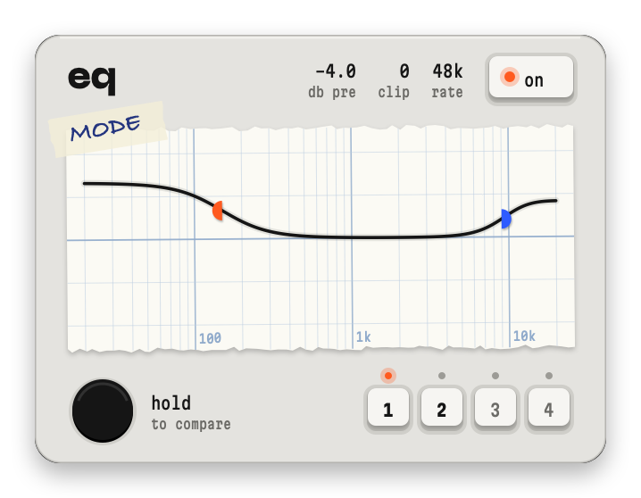

<p align="center"></p>

A system-wide equalizer for macOS that lives in the menu bar. It reshapes everything playing on your output device. There is no audio driver: eq listens through a Core Audio process tap and plays the result back to the same device.

macOS 15 or later, Apple Silicon.

## use

eq runs for a device only when that device has a curve: `~/.config/eq/<device name>.txt`. Double-click the paper to start one. The file is the AutoEQ / Equalizer APO format, and eq applies a saved edit right away:

```
Preamp: auto
Filter 1: ON LSC Fc 150 Hz Gain 4.0 dB Q 0.60
Filter 2: ON HSC Fc 9000 Hz Gain 2.5 dB Q 0.70
```

`PK` is a bell, `LSC` / `HSC` are low and high shelves. `Preamp: auto` lowers the level by the curve's peak, so nothing goes above 0 dB.

| on the face | does |
|---|---|
| drag a dot | frequency and gain |
| scroll on a dot | width |
| double-click the paper | add a band |
| right-click a dot | bell, low shelf, high shelf, remove |
| right-click the paper | add, flatten, open the file |
| hold the black button, or space | hear the original at the same level |
| 1 to 4 | load a preset. Hold the key, or ⌥1 to ⌥4, to save one |
| ⌘Z, ⇧⌘Z | undo, redo |

Right-click the menu-bar glyph for open at login, the curves folder and quit.

## build

```
./build.sh            # build/eq.app
./build.sh install    # copies to ~/Applications and opens it
```

One `swiftc` call, no dependencies. Needs Xcode at `/Applications/Xcode.app`. It signs with your Apple Development identity when there is one, so the System Audio Recording permission survives rebuilds.

## checks

```
build/eq.app/Contents/MacOS/eq selftest cases.json
uv run --no-project --with numpy --with scipy python tools/oracle.py cases.json
python3 tools/rtcheck.py build/eq.app/Contents/MacOS/eq
```

| check | proves |
|---|---|
| selftest | file parsing and round trip, filter spec points, preamp headroom, bit-exact flat, level-matched hold, crossfade |
| oracle | a second implementation in scipy, float64: coefficients, impulse response, frequency response, peak |
| rtcheck | walks the built binary from the audio callback: no allocation, locks, reference counting or runtime calls |

## files

| file | job |
|---|---|
| `Sources/DSP.swift` | curve file, filters, preamp, the realtime processor |
| `Sources/Engine.swift` | the tap, the aggregate device, the audio callback, curve and preset files |
| `Sources/HAL.swift` | Core Audio property helpers |
| `Sources/Face.swift` | the face and the menu-bar glyph |
| `Sources/App.swift` | menu-bar item, panel, undo, presets, hold |
| `Sources/SelfTest.swift` | `eq selftest` |
| `tools/` | `oracle.py`, `rtcheck.py` |
